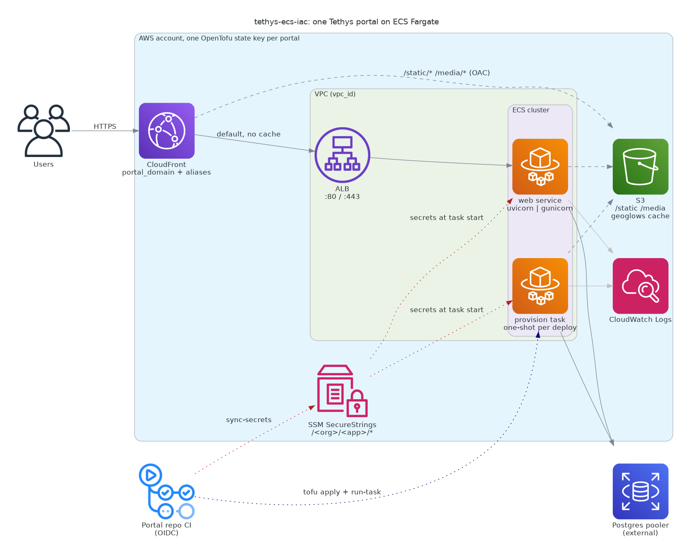

# tethys-ecs-iac

Reusable **OpenTofu** module that runs one [Tethys Platform](https://www.tethysplatform.org/) portal
on **AWS ECS Fargate**. It is stateless (external Postgres pooler, S3 + CloudFront for static/media, no
EFS or Redis). Reuse it per portal with a `*.tfvars` file and a per-portal state key.



| File (`tofu/`) | Creates |
|---|---|
| `network.tf` | ALB, listeners, target group, security groups |
| `static_cdn.tf` | S3 bucket, CloudFront (ALB default, S3 for `/static/*` and `/media/*`), OAC |
| `cluster.tf` | ECS cluster, log group |
| `portal.tf` | `web` service and the one-shot `provision` task definition |
| `roles.tf` | Execution role (ECR, logs, SSM) and task role (S3 write) |

The diagram is generated from [`docs/architecture.py`](docs/architecture.py)
(`uvx --with diagrams python docs/architecture.py`, needs Graphviz). Update it when the module changes.

## Prerequisites
- **OpenTofu >= 1.10** (native S3 state locking, no DynamoDB).
- **State bucket** in S3, versioned and encrypted. Use one key per portal, e.g. `portals/acme.tfstate`.
- **Secrets in SSM** under `/<org>/<app>/*` (see [Secrets](#secrets)). They are not managed by tofu.
- **ACM cert in us-east-1** if you set `portal_domain`. It must cover every `portal_domain_aliases` entry.

## Usage
```bash
cd tofu
cp backend.hcl.example backend.hcl                 # bucket, region, per-portal key
cp examples/portal.tfvars.example acme.tfvars
tofu init -backend-config=backend.hcl
tofu apply -var-file=acme.tfvars
```
Point your DNS CNAME at the `cloudfront_domain` output. `backend.hcl` and real `*.tfvars` are gitignored.

**SSO:** the tofu AWS provider does not refresh SSO tokens. If you get `ExpiredToken`, export
credentials first: `eval "$(aws configure export-credentials --profile <p> --format env)"`.

**Extra domains:** list every hostname CloudFront should answer in `portal_domain_aliases`
(e.g. `["*.portal.example.org"]`). Unlisted hosts get a 403 from CloudFront. Django's `ALLOWED_HOSTS`
and `CSRF_TRUSTED_ORIGINS` for them belong in the portal's own `portal_config.yml`.

## Secrets
GitHub Secrets → `sync-secrets` CI (OIDC) → SSM SecureStrings → injected into the ECS tasks at start.
Nothing secret lands in tofu state or the image.

| GitHub Secret | SSM `/<org>/<app>/…` | Env var |
|---|---|---|
| `DB_PASSWORD` | `db-password` | `TETHYS_DB_PASSWORD` |
| `PS_CONNECTION` | `ps-connection` | `TETHYS_PS_CONNECTION` |
| `SECRET_KEY` | `secret-key` | `TETHYS_SECRET_KEY` (rotating it logs everyone out) |
| `SUPERUSER_PASSWORD` | `portal-superuser-password` | `PORTAL_SUPERUSER_PASSWORD` (`admin`, provision task only) |

## Per-portal CI
This repo holds only the module. Each portal repo owns its tfvars, backend, and CI. Copy
[`examples/portal-ci/`](examples/portal-ci/) into it:

| Template | Purpose |
|---|---|
| `tofu-iam/` | OIDC roles for ECR push and tofu deploy (apply once with admin creds) |
| `tofu-deploy.yml` | `tofu apply`, run the `provision` task, then roll the `web` service |
| `sync-secrets.yml` | Push GitHub Secrets to SSM |

Each portal sets the secret `AWS_DEPLOY_ROLE_ARN` and the variable `AWS_REGION`. Working example:
[`geoglows/enee-geoglows-portal`](https://github.com/geoglows/enee-geoglows-portal).
